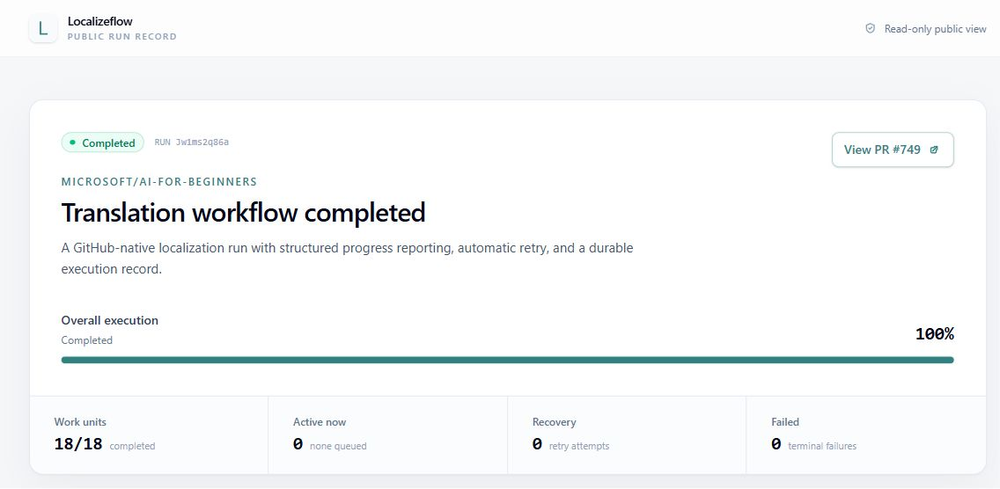
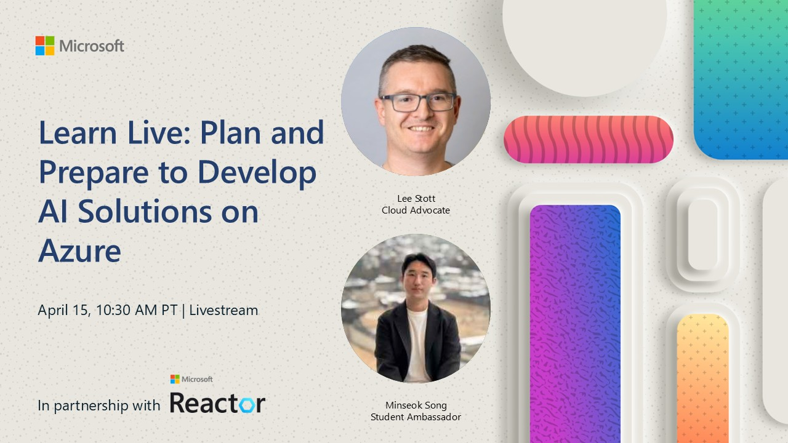

# Hi, I'm Minseok Song

I re-architected [Co-op Translator](https://github.com/Azure/co-op-translator)’s existing proof of concept into a CLI. After the project moved to the Azure GitHub organization, I evolved it into an automated documentation translation workflow and continue to develop and maintain it.

I started programming at 10, making Flash games and sharing them online.

[Microsoft MVP in Microsoft Foundry](https://mvp.microsoft.com/mvp/profile/78bed86f-8f4b-41f9-ba0c-b707ec42e08c)

## Projects I maintain

  <a href="https://github.com/Azure/co-op-translator">
    <picture>
      <source media="(prefers-color-scheme: dark)" srcset="https://github-stats-extended.vercel.app/api/pin/?username=Azure&amp;repo=co-op-translator&amp;theme=dark_github_repocard&amp;description_lines_count=3">
      
    </picture>
  </a>
  <a href="https://github.com/microsoft/generative-ai-for-beginners">
    <picture>
      <source media="(prefers-color-scheme: dark)" srcset="https://github-stats-extended.vercel.app/api/pin/?username=microsoft&amp;repo=generative-ai-for-beginners&amp;theme=dark_github_repocard&amp;description_lines_count=3">
      
    </picture>
  </a>

  <a href="https://github.com/microsoft/ai-agents-for-beginners">
    <picture>
      <source media="(prefers-color-scheme: dark)" srcset="https://github-stats-extended.vercel.app/api/pin/?username=microsoft&amp;repo=ai-agents-for-beginners&amp;theme=dark_github_repocard&amp;description_lines_count=3">
      
    </picture>
  </a>
  <a href="https://github.com/microsoft/mcp-for-beginners">
    <picture>
      <source media="(prefers-color-scheme: dark)" srcset="https://github-stats-extended.vercel.app/api/pin/?username=microsoft&amp;repo=mcp-for-beginners&amp;theme=dark_github_repocard&amp;description_lines_count=3">
      
    </picture>
  </a>

## Featured work

<table>
  <tr>
    <td width="50%" valign="top">
      
       <strong>Localizeflow</strong>
       Translation run for Microsoft's AI-For-Beginners, with public progress tracking.
    </td>
    <td width="50%" valign="top">
      
       <strong>Open at Microsoft</strong>
       Making technical documentation accessible across languages.
    </td>
  </tr>
  <tr>
    <td width="50%" valign="top">
      
       <strong>Microsoft MVP Showcase</strong>
       The Co-op Translator journey from prototype to production.
    </td>
    <td width="50%" valign="top">
      
       <strong>Microsoft Learn Live</strong>
       Planning maintainable AI solutions before implementation.
    </td>
  </tr>
</table>

## Selected writing

- [Build an AI-assisted support email workflow with Power Automate and Microsoft Foundry](https://techcommunity.microsoft.com/blog/azuredevcommunityblog/build-an-ai-assisted-support-email-workflow-with-power-automate-and-microsoft-fo/4554297) *(Sep 9, 2026)*
- [Fixing Broken Markdown in AI Translation: Hardening a Production Pipeline](https://techcommunity.microsoft.com/blog/azuredevcommunityblog/fixing-broken-markdown-in-ai-translation-hardening-a-production-pipeline/4511378) *(Apr 30, 2026)*
- [Rethinking Documentation Translation: Treating Translations as Versioned Software Assets](https://techcommunity.microsoft.com/blog/azuredevcommunityblog/rethinking-documentation-translation-treating-translations-as-versioned-software/4491755) *(Feb 4, 2026)*
- [Co-op Translator: Current Status and v0.10.0 Release](https://techcommunity.microsoft.com/blog/educatordeveloperblog/co-op-translator-current-status-and-v0-10-0-release/4446253) *(Aug 25, 2025)*
- [Automate Markdown and Image Translations Using Co-op Translator](https://techcommunity.microsoft.com/blog/educatordeveloperblog/automate-markdown-and-image-translations-using-co-op-translator-phi-3-cookbook-c/4263474) *(Oct 15, 2024)*
- [Teach ChatGPT to Answer Questions with Azure AI Search and Azure OpenAI](https://techcommunity.microsoft.com/blog/educatordeveloperblog/teach-chatgpt-to-answer-questions-using-azure-ai-search--azure-openai-lang-chain/3969713) *(Nov 2, 2023)*

[Website](https://www.mssong.com/) · [Writing](https://www.mssong.com/writing/) · [Talks](https://www.mssong.com/talks/) · [LinkedIn](https://www.linkedin.com/in/ms-song/)

